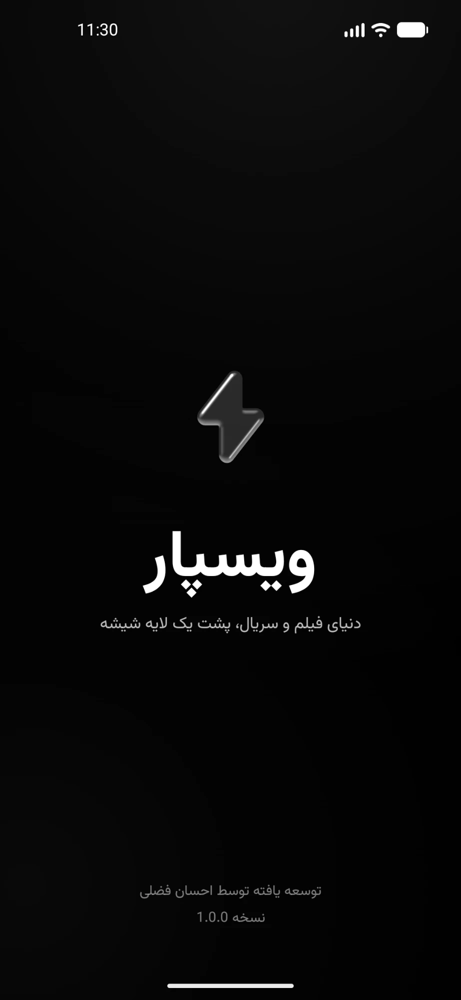
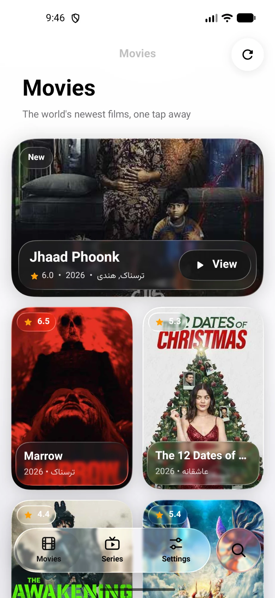

<div dir="rtl">

<p align="center">
  
</p>

<h1 align="center">ویسپار</h1>

<p align="center">
  <b>فیلم و سریال، پشت شیشهٔ مایع.</b><br>
  برنامهٔ بومی اندروید و Android TV، نوشته‌شده با Kotlin و Jetpack Compose.
</p>

<p align="center">
  <a href="https://github.com/TssHack/vispar-app/actions/workflows/android.yml"></a>
  <a href="https://github.com/TssHack/vispar-app/releases/latest"></a>
  
  
  
  <a href="LICENSE"></a>
</p>

<p align="center">
  <a href="https://tsshack.github.io/vispar-website/"><b>وبسایت</b></a> · <a href="https://github.com/TssHack/vispar-app/releases/latest"><b>دانلود</b></a> · <a href="README.md">English</a> · <a href="https://ehsanfazli.ir">توسعه‌دهنده</a>
</p>

<p align="center">
  
  &nbsp;
  
</p>

---

## چرا ویسپار

ویسپار یک برنامهٔ پخش فیلم و سریال است که از ابتدا برای فارسی و به‌صورت بومی برای اندروید ساخته شده. کل رابط کاربری از شیشهٔ مایع است: پنل‌ها هرچه پشتشان هست را محو و خم می‌کنند، دکمه‌ها زیر انگشت باد می‌کنند و کنترل‌های پخش‌کننده تصویر فیلم در حال پخش را می‌شکنند.

- **یک برنامه برای دو فضا.** در گوشی و تبلت نوار شیشه‌ای شناور، و در Android TV نوار کناری با حلقهٔ فوکوس و ناوبری با ریموت.
- **راست‌به‌چپ از روز اول.** زبان پیش‌فرض فارسی است، انگلیسی با یک لمس فعال می‌شود و جهت چیدمان از زبان پیروی می‌کند.
- **کم‌حجم.** فایل نصبی حدود ۳٫۷ مگابایت است.

## امکانات

| | |
| --- | --- |
| **رابط شیشهٔ مایع** | محوشدگی، شکست نور و بازتاب به‌صورت زنده، با چهار جنس قابل انتخاب: شفاف، شیشه، مات و بدون شفافیت. |
| **پخش‌کننده** | بر پایهٔ Media3 ExoPlayer با پشتیبانی از HLS و DASH. سرعت پخش از ۰٫۷۵ تا ۲ برابر، بازهٔ پرش قابل تنظیم، ادامه از آخرین موقعیت، پخش خودکار و زیرنویس با ظاهر قابل تنظیم. |
| **ادامهٔ تماشا** | ردیفی در برگه‌های فیلم و سریال که از همان‌جا که متوقف کردید ادامه می‌دهد. |
| **علاقه‌مندی‌ها** | فیلم‌ها و سریال‌ها را ذخیره کنید، تک‌تک حذف کنید یا کل فهرست را پاک کنید. |
| **جست‌وجو** | یک جست‌وجو برای فیلم و سریال. |
| **حساب و همگام‌سازی** | ورود با شمارهٔ موبایل و کد پیامکی. علاقه‌مندی‌ها و ادامهٔ تماشا بین گوشی و تلویزیون یکسان می‌ماند و می‌توانید دستگاه‌های دیگر را از راه دور خارج کنید. |
| **دانلود** | کیفیت را انتخاب کنید و فایل را به مرورگر، ADM یا VLC بسپارید. |
| **شخصی‌سازی** | پوستهٔ روشن، تیره یا سیستم، رنگ‌های تک‌رنگ یا سیستمی، پوسترهای فشرده و بازخورد لمسی. |
| **Android TV** | بنر لانچر، نوار کناری شیشه‌ای، حلقهٔ فوکوس روی همهٔ کنترل‌ها و پخش‌کننده‌ای که با ریموت کار می‌کند. |

## دانلود

هر [انتشار](https://github.com/TssHack/vispar-app/releases/latest) فایل‌های APK امضاشده را در دو نسخه دارد.

| نسخه | فایل | مناسب برای |
| --- | --- | --- |
| گوشی و تبلت | `Vispar-<version>-android-<abi>.apk` | گوشی و تبلت. اگر دستگاه خودش را تلویزیون معرفی کند، رابط تلویزیون را نشان می‌دهد. |
| Android TV | `Vispar-<version>-android-tv-<abi>.apk` | تلویزیون و TV Box. همیشه رابط تلویزیون را نشان می‌دهد، حتی روی باکس‌هایی که خودشان را تبلت معرفی می‌کنند. |

معماری متناسب با دستگاه را بردارید، یا اگر مطمئن نیستید `universal` را.

| `<abi>` | دستگاه‌ها |
| --- | --- |
| `universal` | همهٔ دستگاه‌ها. کمی حجیم‌تر است. |
| `arm64-v8a` | بیشتر گوشی‌های چند سال اخیر، تلویزیون‌ها و باکس‌های جدیدتر. |
| `armeabi-v7a` | گوشی‌های قدیمی‌تر و بسیاری از TV Boxها. |
| `x86_64` و `x86` | شبیه‌سازها و دستگاه‌های اینتل. |

هر دو نسخه یک شناسهٔ برنامه و یک کلید امضا دارند، پس هرکدام را می‌شود روی دیگری نصب کرد. فایل `SHA256SUMS.txt` در هر انتشار چک‌سام فایل‌ها را دارد.

ویسپار به اندروید ۷٫۰ (API 24) یا بالاتر نیاز دارد. محوشدگی کامل از اندروید ۱۲ و شکست نور از اندروید ۱۳ کار می‌کند؛ دستگاه‌های قدیمی‌تر یک لایهٔ مات می‌بینند.

## ریموت کنترل

| کلید | در برنامه | در پخش‌کننده |
| --- | --- | --- |
| جهت‌ها | جابه‌جایی فوکوس | چپ و راست پرش، بالا و پایین نمایش کنترل‌ها |
| OK | باز کردن | پخش یا توقف |
| Back | بازگشت | بستن پخش‌کننده |
| کلیدهای رسانه | | پخش، توقف، پرش |

## ساخت از سورس

به JDK 17 یا بالاتر و Android SDK (API 37) نیاز دارید. Android Studio هر دو را نصب می‌کند.

<div dir="ltr">

```bash
git clone https://github.com/TssHack/vispar-app.git
```

```bash
cd vispar-app
```

```bash
./gradlew assembleRelease
```

</div>

فایل‌های APK در `app/build/outputs/apk/mobile/release` و `app/build/outputs/apk/tv/release` ساخته می‌شوند. برای ساخت فقط یک نسخه، `assembleMobileRelease` یا `assembleTvRelease` را اجرا کنید.

### امضا

بدون کلید، نسخهٔ release با کلید debug امضا می‌شود تا برای تست قابل نصب باشد. برای امضا با کلید خودتان، پیش از ساخت این متغیرها را تنظیم کنید:

| متغیر | مقدار |
| --- | --- |
| `VISPAR_KEYSTORE` | مسیر فایل keystore |
| `VISPAR_KEYSTORE_PASSWORD` | رمز keystore |
| `VISPAR_KEY_ALIAS` | اختیاری. پیش‌فرض `vispar` |
| `VISPAR_KEY_PASSWORD` | اختیاری. پیش‌فرض همان رمز keystore |

### انتشار

[`android.yml`](.github/workflows/android.yml) با هر push به `main` هر دو نسخه را برای همهٔ معماری‌ها می‌سازد. با push کردن تگی که با شمارهٔ نسخه یکی باشد، مثل `v1.0.0`، فایل‌ها با کلید ذخیره‌شده در secretهای `VISPAR_KEYSTORE_BASE64` و `VISPAR_KEYSTORE_PASSWORD` امضا می‌شوند، امضای تک‌تک آن‌ها بررسی می‌شود و به انتشار گیت‌هاب پیوست می‌شوند.

## ساختار پروژه

<div dir="ltr">

```
app/src/main/java/com/fazli/vispar
├── MainActivity.kt            Single activity, navigation host
├── VideoPlayerActivity.kt     Player
├── account/                   Sign-in, sync, announcements and forced updates
├── data/                      API client, models and repositories
├── navigation/                Routes, glass tab bar, TV sidebar
├── screens/                   Movies, series, details, search, favourites, settings
├── ui/glass/                  The liquid glass design system
├── ui/theme/                  Theme and theme settings
└── utils/                     Device, language, storage and watch history helpers
```

</div>

### سیستم طراحی شیشه

همه‌چیز روی صفحه از چند جزء کوچک در `ui/glass` ساخته شده است:

| جزء | کارکرد |
| --- | --- |
| `AmbientBackground` | زمینهٔ خنثی: سیاه خالص در حالت تیره، سفید تا خاکستری سیستم در حالت روشن. |
| `GlassSurface` و `glass()` | پنل‌های محو، اشباع‌شده و عدسی‌وار. کنترل‌های تودرتو پنل والدشان را می‌شکنند. |
| `LiquidButton` | دکمه‌های کپسولی که مثل قطرهٔ آب باد می‌کنند و انگشت را دنبال می‌کنند. |
| `LiquidTabs` | نوار برگهٔ شناور و کنترل‌های چندبخشی، با عدسی قابل کشیدن که با سرعت کش می‌آید. |
| `LiquidSlider` | دستگیرهٔ شیشه‌ای که هنگام کشیدن مسیر را بزرگ‌نمایی می‌کند. |
| `LiquidToggle` | کلید با دستگیرهٔ شیشهٔ مایع. |
| `GlassScaffold` | نوار بالای شیشه‌ای شناور با محوشدگی تدریجی زیر نوار وضعیت. |
| `GlassDialog` | دیالوگ‌هایی که در لایه‌ای داخل پنجره رسم می‌شوند تا کل صفحه را بشکنند. |

پخش‌کننده در یک `TextureView` رسم می‌شود و همین باعث می‌شود کنترل‌هایش بتوانند تصویر ویدیو را بشکنند.

## ساخته‌شده با

- [Kotlin](https://kotlinlang.org) و [Jetpack Compose](https://developer.android.com/compose) با Material 3
- [AndroidLiquidGlass](https://github.com/Kyant0/AndroidLiquidGlass) (Backdrop) برای محوشدگی، شکست نور و بازتاب
- [Media3 ExoPlayer](https://developer.android.com/media/media3) برای پخش
- [Coil](https://coil-kt.github.io/coil/) برای تصاویر
- [OkHttp](https://square.github.io/okhttp/)، kotlinx.serialization و coroutines برای شبکه
- Navigation Compose و Leanback

## مرتبط

[TssHack/vispar](https://github.com/TssHack/vispar) نسخهٔ چندسکویی ویسپار است که با React Native برای اندروید، iOS، وب و دسکتاپ ساخته شده.

## مشارکت

Issue و Pull Request خوش‌آمد است. برای هر چیزی بزرگ‌تر از یک اصلاح کوچک، لطفاً اول یک issue باز کنید تا پیش از نوشتن کد روی روش توافق شود.

## مجوز

[MIT](LICENSE)

## سازنده

**احسان فضلی** · [ehsanfazli.ir](https://ehsanfazli.ir) · [@TssHack](https://github.com/TssHack)

</div>
